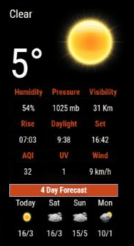
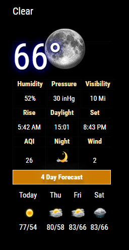
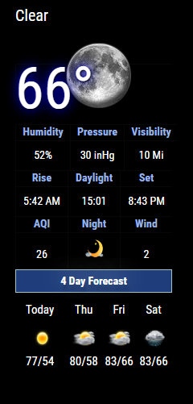
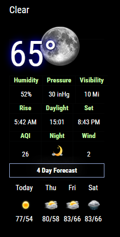
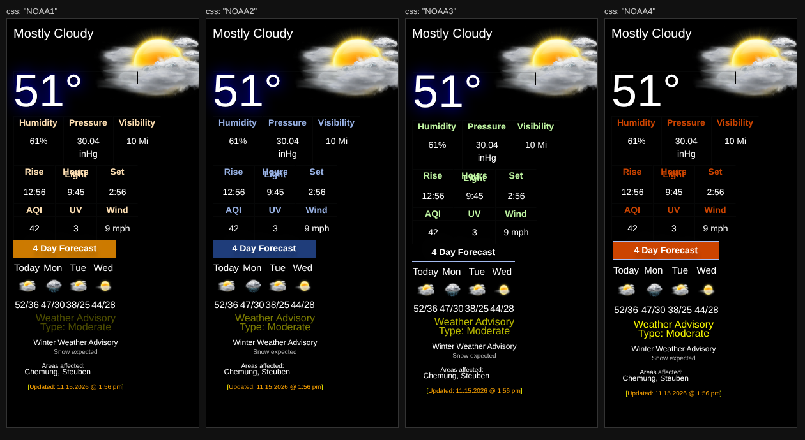
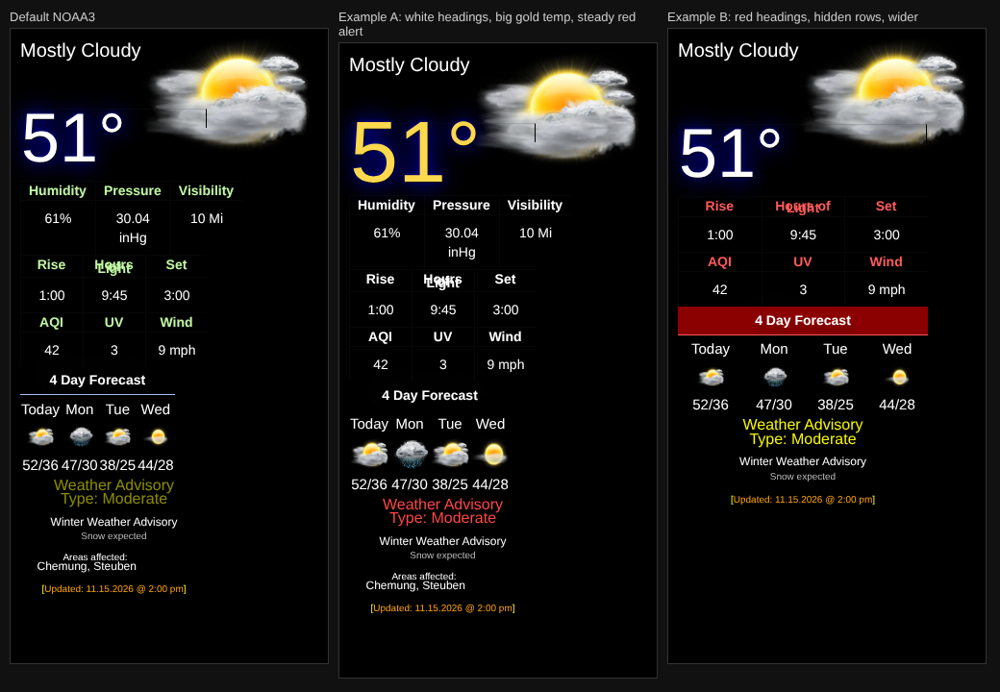

# MMM-NOAAV4

Weather for [MagicMirror²](https://github.com/MagicMirrorOrg/MagicMirror): current conditions, a
4-day forecast, sunrise and sunset, hours of daylight, UV index, air quality (AQI), the moon phase at
night, and US National Weather Service alerts.

- Works with current MagicMirror² (2.3x) on Node.js 22 or newer
- No API key needed by default
- No npm packages to install
- Four color styles, and every part can be restyled with `custom.css`

## Screenshots

| NOAA4 (default), daytime, metric | NOAA1, night, imperial | NOAA2, night, imperial | NOAA3, night, imperial |
|:---:|:---:|:---:|:---:|
|  |  |  |  |

In the daytime the middle box of the bottom row shows the **UV index**. At night it shows the
**moon phase** instead.

All four styles side by side, with a weather alert showing:



---

## Contents

- [Screenshots](#screenshots)
- [Requirements](#requirements)
- [Install](#install)
- [Add it to your config](#add-it-to-your-config)
- [Start MagicMirror and check it](#start-magicmirror-and-check-it)
- [Configuration options](#configuration-options)
- [°F or °C, and 12- or 24-hour time](#f-or-c-and-12--or-24-hour-time)
- [Weather providers](#weather-providers)
- [Styles](#styles)
- [Custom CSS](#custom-css)
- [Your own moon pictures](#your-own-moon-pictures)
- [Mouseover](#mouseover)
- [Updating](#updating)
- [Upgrading from MMM-NOAA3](#upgrading-from-mmm-noaa3)
- [Troubleshooting](#troubleshooting)
- [Running the tests](#running-the-tests)
- [What changed in v4](#what-changed-in-v4)

---

## Requirements

- [MagicMirror²](https://docs.magicmirror.builders/getting-started/installation.html) 2.3x, installed
  in `~/MagicMirror`
- Node.js 22 or newer. Check with:

  ```bash
  node -v
  ```

- Your latitude and longitude. You can look them up at https://www.latlong.net

---

## Install

```bash
cd ~/MagicMirror/modules
git clone https://github.com/cowboysdude/MMM-NOAAV4
```

That's all.

> **Do I need to run `npm install`?** **No.** The module has no dependencies, so there is nothing
> for npm to install. (Running it anyway does no harm.)

> The folder **must** be named `MMM-NOAAV4`, the same as the module name. MagicMirror won't find
> the module in a folder with any other name.

---

## Add it to your config

Open `~/MagicMirror/config/config.js` and add this inside the `modules: [ ... ]` list:

```js
{
  module: "MMM-NOAAV4",
  position: "top_right",
  config: {
    lat: 42.0917,     // your latitude
    lon: -76.8400     // your longitude
  }
},
```

This is the smallest config that works. It uses free Open-Meteo data, needs no key, and takes its
units, time format and language from the top of your `config.js`.

A fuller example:

```js
{
  module: "MMM-NOAAV4",
  position: "top_right",
  config: {
    provider: "nws",          // NOAA / National Weather Service (USA), no key needed
    lat: 42.0917,
    lon: -76.8400,
    units: "imperial",        // °F, mph, inHg, miles
    css: "NOAA4",             // color style
    alerts: true,             // show NWS weather alerts
    nupdate: true,            // show "Updated: ..." at the bottom
    updateInterval: 30 * 60 * 1000
  }
},
```

> **Tip:** if you already have MagicMirror's built-in `weather` module in your config, remove it or
> comment it out, unless you want both on screen.

---

## Start MagicMirror and check it

MagicMirror only reads `config.js` when it starts, so restart it after any config change.

```bash
cd ~/MagicMirror
node --run start            # Raspberry Pi OS / Wayland desktops
node --run start:x11        # X11 desktops (Linux Mint, Ubuntu on X11, etc.)
```

To quit the full-screen mirror, press **`Ctrl+Q`**.

**Testing tip:** to try things without the mirror taking over your screen, run it as a server and
open it in a normal browser tab:

```bash
cd ~/MagicMirror
node --run server
```

Then go to http://localhost:8080. Press `Ctrl+C` in the terminal to stop it.

While the module loads its first data, it shows *"Gathering your weather info.."*. If something is
wrong, the error appears on the mirror in plain words, and also in the terminal with
`[MMM-NOAAV4]` in front of it.

---

## Configuration options

| Option | Default | What it does |
|---|---|---|
| `lat` / `lon` | — | **Required.** Your latitude and longitude. The old names `userlat` / `userlon` also work. |
| `provider` | `"openmeteo"` | Where the weather comes from. See [Weather providers](#weather-providers). |
| `apiKey` | `""` | Key for the providers that need one. |
| `zip` | `""` | AccuWeather only: your AccuWeather location number (not your ZIP code). |
| `units` | from `config.js` | `"imperial"` (°F, mph, inHg, miles) or `"metric"` (°C, km/h, mb, km). Set it here to override the units at the top of `config.js` for this module only. |
| `css` | `""` | Color style: `"NOAA1"`, `"NOAA2"`, `"NOAA3"`, or leave it out for the NOAA4 look. See [Styles](#styles). |
| `alerts` | `true` | Show active US National Weather Service alerts for your location. |
| `nupdate` | `false` | Show an "Updated: …" line at the bottom. |
| `updateInterval` | `30 * 60 * 1000` | How often to fetch new weather, in milliseconds. The minimum is 10 minutes. |
| `rotateInterval` | `60 * 1000` | How long each alert stays on screen when there are several. |
| `animationSpeed` | `0` | Fade time in milliseconds when the display refreshes. |
| `lang` | from `config.js` | Language for the weather service's descriptions, e.g. `"en"`, `"de"`. |
| `moon` | built in | Swap in your own moon pictures. See [Your own moon pictures](#your-own-moon-pictures). |

**No longer used:** `airKey` (AQI no longer needs a key), `pws`, `appID`, `initialLoadDelay`, `frow`
and `uvScale`. Leaving any of these in your config is harmless.

---

## °F or °C, and 12- or 24-hour time

Both are set at the top of `~/MagicMirror/config/config.js`, and they apply to the whole mirror:

```js
const config = {
  ...
  timeFormat: 12,        // 12 = 4:42  |  24 = 16:42
  units: "imperial",     // "imperial" = °F  |  "metric" = °C
  ...
```

- **`timeFormat`** controls the clock and this module's sunrise, sunset and "Updated" times.
- **`units`** is the default for every module. To give *only* this module different units, add
  `units` to its own `config` block:

  ```js
  config: {
    lat: 42.0917,
    lon: -76.8400,
    units: "imperial"
  }
  ```

---

## Weather providers

| `provider` | Key? | Notes |
|---|---|---|
| `openmeteo` | No | **Default.** Free and worldwide. https://open-meteo.com |
| `nws` | No | NOAA / National Weather Service. **USA only.** Uses real station observations. |
| `pirateweather` | Free key | Replacement for Dark Sky with the same data format. https://pirateweather.net |
| `openweather` | Free key | Uses the free endpoints. https://openweathermap.org |
| `weatherbit` | Key | https://www.weatherbit.io |
| `accuweather` | Free key | Also needs `zip` (see below). Free keys allow very few calls a day, so use `updateInterval: 60 * 60 * 1000`. |

**AccuWeather location number:** find your town on accuweather.com and open its forecast page. The
number at the end of the address is what goes in `zip`, e.g. `.../weather-forecast/330275` →
`zip: "330275"`.

**These are the same for every provider:**
- Sunrise, sunset, daylight and UV come from Open-Meteo, with no key needed.
- AQI is the US AQI from the Open-Meteo air-quality API, with no key needed.
- The moon phase is calculated by the module itself.
- Alerts come from the National Weather Service (US only). Pirate Weather uses its own alerts instead.

**Retired services** are switched over automatically, with a note in the log:
- `darksky` → `pirateweather`. You need a Pirate Weather key, because Dark Sky keys no longer work.
- `wunderground`, `apixu`, `msn`, `weatherunlocked` and `yahoo` → `openmeteo`.

**Examples:**

```js
// NOAA / National Weather Service (USA), no key
config: { provider: "nws", lat: 42.0917, lon: -76.84 }

// Pirate Weather
config: { provider: "pirateweather", apiKey: "YOUR_KEY", lat: 42.0917, lon: -76.84 }

// OpenWeather
config: { provider: "openweather", apiKey: "YOUR_KEY", lat: 42.0917, lon: -76.84 }

// AccuWeather
config: { provider: "accuweather", apiKey: "YOUR_KEY", zip: "330275", lat: 42.0917, lon: -76.84,
          updateInterval: 60 * 60 * 1000 }
```

---

## Styles

Pick a color style with `css:`


| `css:` | Look |
|---|---|
| `"NOAA1"` | Gold headings |
| `"NOAA2"` | Blue headings |
| `"NOAA3"` | Green headings |
| `"NOAA4"`, anything else, or leave it out | NOAA4: color-cycling headings, centered alert block |

All styles only affect this module. They don't change the look of your other modules.

---

## Custom CSS

To change colors, sizes or anything else, edit `~/MagicMirror/css/custom.css`. That file is never
overwritten by updates. Start each rule with `.MMM-NOAAV4` so it only affects this module, then
restart or reload the mirror.

**What each part is called:**

| Part of the display | CSS selector |
|---|---|
| The whole module (195px wide) | `.MMM-NOAAV4` |
| Condition text ("Mostly Cloudy") | `.MMM-NOAAV4 .floatl` |
| Big current-condition icon | `.MMM-NOAAV4 .img img` |
| Big temperature | `.MMM-NOAAV4 .divTableCell2` |
| Little headings (Humidity, Rise, AQI…) | `.MMM-NOAAV4 .divTableHead` |
| Values under the headings | `.MMM-NOAAV4 .divTableCell` |
| Humidity / Pressure / Visibility block | `.MMM-NOAAV4 .topshow` |
| "4 Day Forecast" bar | `.MMM-NOAAV4 .rheading` |
| Forecast day names and temperatures | `.MMM-NOAAV4 .table td` |
| Forecast icons | `.MMM-NOAAV4 .CellWithComment img` |
| Forecast hover text | `.MMM-NOAAV4 .CellComment` |
| "Weather Advisory" (blinking) | `.MMM-NOAAV4 .advise` |
| Alert name / alert details | `.MMM-NOAAV4 .warning` / `.MMM-NOAAV4 .adesc` |
| "Areas affected" label / list | `.MMM-NOAAV4 .areas` / `.MMM-NOAAV4 .list` |

**Examples.** Copy whichever you want into `custom.css`:



```css
/* Plain white headings */
.MMM-NOAAV4 .rheading     { background-color: #000; border: none; color: #fff; animation: none; }
.MMM-NOAAV4 .divTableHead { color: #fff; animation: none; }

/* Your own heading color, e.g. red */
.MMM-NOAAV4 .divTableHead { color: #ff5a5a; animation: none; }
.MMM-NOAAV4 .rheading     { background-color: #8b0000; border-color: #ff5a5a; animation: none; }

/* Bigger or smaller temperature, in any color */
.MMM-NOAAV4 .divTableCell2 { font-size: 90px; color: #ffd84d; }

/* Make the whole module wider (the second line stretches the tables to fit) */
.MMM-NOAAV4 { width: 260px; }
.MMM-NOAAV4 .divTable, .MMM-NOAAV4 .table { width: 100%; }

/* Bigger forecast icons */
.MMM-NOAAV4 .CellWithComment img { width: 40px; height: 32px; }

/* Stop the alert from blinking, and make it red */
.MMM-NOAAV4 .advise { animation: none; color: #ff4444; }

/* Hide parts you don't want */
.MMM-NOAAV4 .topshow { display: none; }                         /* Humidity / Pressure / Visibility */
.MMM-NOAAV4 .adesc   { display: none; }                         /* alert details */
.MMM-NOAAV4 .areas, .MMM-NOAAV4 .list { display: none; }        /* areas affected */

/* Dim the whole module */
.MMM-NOAAV4 { opacity: 0.7; }
```

The NOAA4 style cycles its heading colors. Add `animation: none;` as shown above when you set your
own heading color, or the cycling will paint over it.

---

## Your own moon pictures

Put your pictures in the module's `images/moon/` folder and list them in your config. You only
need the phases you want to change:

```js
config: {
  lat: 42.0917,
  lon: -76.8400,
  moon: {
    "Full Moon": "images/moon/my-full-moon.png",
    "New Moon": "images/moon/my-new-moon.png"
  }
}
```

Phase names: New Moon, Waxing Crescent, First Quarter, Waxing Gibbous, Full Moon, Waning Gibbous,
Last Quarter, Waning Crescent.

---

## Mouseover

On a touch screen, or with a mouse plugged in:
- Hover over the big temperature to see today's forecast text.
- Hover over a forecast icon to see that day's forecast.

Other modules can use the `WEATHER` notification this module sends (`{ icon, sunset }`).

---

## Updating

```bash
cd ~/MagicMirror/modules/MMM-NOAAV4
git pull
```

Then restart MagicMirror.

---

## Upgrading from MMM-NOAA3

v4 lives in this repository under the new module name **`MMM-NOAAV4`**.

1. Move the old module out of the way and install v4:

   ```bash
   cd ~/MagicMirror/modules
   mv MMM-NOAA3 MMM-NOAA3-old
   git clone https://github.com/cowboysdude/MMM-NOAAV4
   ```

2. In `~/MagicMirror/config/config.js`, change

   ```js
   module: "MMM-NOAA3",
   ```

   to

   ```js
   module: "MMM-NOAAV4",
   ```

3. In `~/MagicMirror/css/custom.css`, change any `.MMM-NOAA3` rules to `.MMM-NOAAV4`.

4. If you had your own moon pictures in `MMM-NOAA3-old/images/moon/`, copy them into
   `MMM-NOAAV4/images/moon/`.

5. Restart MagicMirror. Once v4 is working, delete `MMM-NOAA3-old`.

Everything else in your config can stay as it is: `userlat` and `userlon` still work, and retired
providers are switched over automatically.

---

## Troubleshooting

| What you see | What to do |
|---|---|
| MagicMirror says it can't find the module | The folder must be `~/MagicMirror/modules/MMM-NOAAV4`, spelled exactly like that. |
| Module shows nothing, or "Gathering your weather info.." never goes away | Check the terminal for lines starting with `[MMM-NOAAV4]`. Make sure `lat` and `lon` are set. |
| `Set lat and lon (or userlat and userlon)` | Add your `lat` and `lon` to the module's `config` block. |
| Error about the API key | Check `apiKey` for the provider you picked, or switch to `openmeteo` or `nws`, which need no key. |
| AccuWeather stops working partway through the day | The free key ran out of calls. Use `updateInterval: 60 * 60 * 1000` or another provider. |
| Temperatures in the wrong unit | Set `units` at the top of `config.js`, or in the module's own `config` block. Then restart. |
| Times in the wrong format | Set `timeFormat: 12` or `24` at the top of `config.js`. Then restart. |
| No alerts showing | Alerts come from the US National Weather Service, so they only show for US locations, and only when there's an active alert. |
| AQI shows `--` | Air-quality data isn't available for every location. |
| Config changes don't show up | MagicMirror only reads `config.js` at startup. Restart it. |
| `node: bad option: --run` | Your Node.js is older than 22. Update Node, then run `node --run install-mm` in `~/MagicMirror`. |
| `Failed to connect to Wayland display` | Your desktop uses X11. Start with `node --run start:x11` instead. |

---

## Running the tests

```bash
cd ~/MagicMirror/modules/MMM-NOAAV4
npm test
```

---

## What changed in v4

- **Works on current MagicMirror and Node 22:** replaced the removed `request` library with
  Node's built-in `fetch`, and removed all npm dependencies.
- **Module renamed to `MMM-NOAAV4`** to match the repository, so it installs with a plain
  `git clone`.
- **Styles load properly:** the stylesheet is loaded from the module's own folder. Before, it showed
  up unstyled in a single column.
- **Styles stay inside the module:** every CSS rule is scoped to `.MMM-NOAAV4`, so the module no
  longer changes how other modules (like the calendar) look.
- **Forecast rows fixed:** icons no longer overlap the high/low temperatures.
- **Server-side crash fixed:** the helper no longer uses a global `config` that doesn't exist on
  the server.
- **Providers:** added Open-Meteo (default), NOAA/NWS and Pirate Weather, and dropped dead services.
  The moon phase is now calculated locally instead of using a dead API. AQI no longer needs a key.
- **More than one copy can run at once,** each with its own settings, and a browser reload
  doesn't start a second set of updates.
- **Clearer display:** missing values show `--` instead of `NaN` or `undefined`, and errors show
  on the mirror in plain words.
- **Danish translation** is now saved as UTF-8.

---

By **cowboysdude**, with huge thanks to JimL at https://www.phphelp.com.
