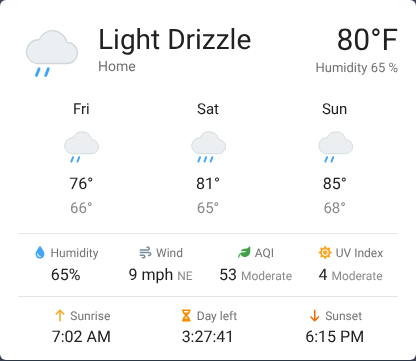
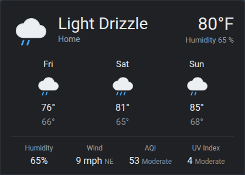
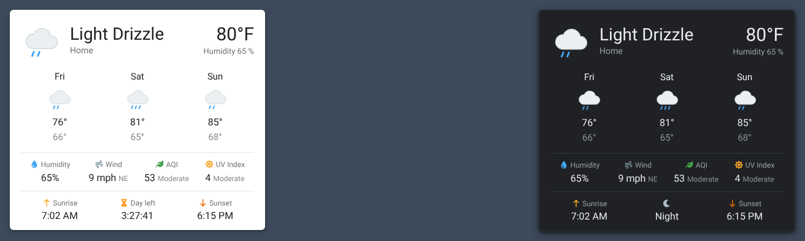

# MMM-NOAAV4

Weather for [MagicMirror²](https://github.com/MagicMirrorOrg/MagicMirror) on a clean weather card:
current conditions, today's high and low, a 3-day forecast, humidity, wind, air quality (AQI),
UV index, sunrise and sunset with a live countdown to sunset, and US National Weather Service
alerts. Comes in **white** and **dark**.

- Works with current MagicMirror² (2.3x) on Node.js 22 or newer
- No API key needed by default
- No npm packages to install
- Sharp built-in weather icons that look right at any size

## Screenshots

| White (default) | Dark (`css: "dark"`) |
|:---:|:---:|
|  |  |

Top row: current condition, your location name, the temperature, and today's high and low.
Middle: the next 3 days. Below that: humidity, wind speed and direction, air quality and UV index.
Then the sun row: sunrise, a live countdown to sunset, and sunset (see [Sun row](#sun-row)).
Any active weather alert shows as a strip at the very bottom.

---

## Contents

- [Screenshots](#screenshots)
- [Requirements](#requirements)
- [Install](#install)
- [Add it to your config](#add-it-to-your-config)
- [Start MagicMirror and check it](#start-magicmirror-and-check-it)
- [Configuration options](#configuration-options)
- [°F or °C, and 12- or 24-hour time](#f-or-c-and-12--or-24-hour-time)
- [Weather providers](#weather-providers)
- [Sun row](#sun-row)
- [White or dark](#white-or-dark)
- [Custom CSS](#custom-css)
- [Mouseover](#mouseover)
- [Updating](#updating)
- [Upgrading from MMM-NOAA3](#upgrading-from-mmm-noaa3)
- [Troubleshooting](#troubleshooting)
- [Running the tests](#running-the-tests)
- [What changed in v4.2](#what-changed-in-v42) · [v4.1](#what-changed-in-v41) · [v4](#what-changed-in-v4)

---

## Requirements

- [MagicMirror²](https://docs.magicmirror.builders/getting-started/installation.html) 2.3x, installed
  in `~/MagicMirror`
- Node.js 22 or newer. Check with:

  ```bash
  node -v
  ```

- Your latitude and longitude. You can look them up at https://www.latlong.net

---

## Install

```bash
cd ~/MagicMirror/modules
git clone https://github.com/cowboysdude/MMM-NOAAV4
```

That's all.

> **Do I need to run `npm install`?** **No.** The module has no dependencies, so there is nothing
> for npm to install. (Running it anyway does no harm.)

> The folder **must** be named `MMM-NOAAV4`, the same as the module name. MagicMirror won't find
> the module in a folder with any other name.

---

## Add it to your config

Open `~/MagicMirror/config/config.js` and add this inside the `modules: [ ... ]` list:

```js
{
  module: "MMM-NOAAV4",
  position: "top_right",
  config: {
    lat: 42.0917,     // your latitude
    lon: -76.8400     // your longitude
  }
},
```

This is the smallest config that works. It uses free Open-Meteo data, needs no key, and takes its
units, time format and language from the top of your `config.js`.

A fuller example:

```js
{
  module: "MMM-NOAAV4",
  position: "top_right",
  config: {
    provider: "nws",          // NOAA / National Weather Service (USA), no key needed
    lat: 42.0917,
    lon: -76.8400,
    units: "imperial",        // °F, mph, miles
    css: "dark",              // "light" (white, default) or "dark"
    title: "Home Weather",    // name under the condition
    forecastDays: 3,          // 0 to 5
    sun: true,                // sunrise, countdown to sunset, sunset
    alerts: true,             // show NWS weather alerts
    updateInterval: 30 * 60 * 1000
  }
},
```

> **Tip:** if you already have MagicMirror's built-in `weather` module in your config, remove it or
> comment it out, unless you want both on screen.

---

## Start MagicMirror and check it

MagicMirror only reads `config.js` when it starts, so restart it after any config change.

```bash
cd ~/MagicMirror
node --run start            # Raspberry Pi OS / Wayland desktops
node --run start:x11        # X11 desktops (Linux Mint, Ubuntu on X11, etc.)
```

To quit the full-screen mirror, press **`Ctrl+Q`**.

**Testing tip:** to try things without the mirror taking over your screen, run it as a server and
open it in a normal browser tab:

```bash
cd ~/MagicMirror
node --run server
```

Then go to http://localhost:8080. Press `Ctrl+C` in the terminal to stop it.

While the module loads its first data, it shows *"Gathering your weather info.."*. If something is
wrong, the error appears on the mirror in plain words, and also in the terminal with
`[MMM-NOAAV4]` in front of it.

---

## Configuration options

| Option | Default | What it does |
|---|---|---|
| `lat` / `lon` | — | **Required.** Your latitude and longitude. The old names `userlat` / `userlon` also work. |
| `provider` | `"openmeteo"` | Where the weather comes from. See [Weather providers](#weather-providers). |
| `apiKey` | `""` | Key for the providers that need one. |
| `zip` | `""` | AccuWeather only: your AccuWeather location number (not your ZIP code). |
| `units` | from `config.js` | `"imperial"` (°F, mph) or `"metric"` (°C, km/h). Set it here to override the units at the top of `config.js` for this module only. |
| `css` | `"light"` | `"light"` for the white card or `"dark"` for the dark card. See [White or dark](#white-or-dark). |
| `title` | `"Home"` | The name shown under the condition, e.g. `"Home Weather"` or your town. |
| `forecastDays` | `3` | How many days in the forecast row, `0` to `5`. With `0` the card is just the top row, and it shows humidity under the temperature instead of today's high and low. |
| `details` | `true` | The row with humidity, wind, AQI and UV index. `false` hides it. |
| `sun` | `true` | The sun row: sunrise, a live countdown to sunset (or **Night** after dark), and sunset. `false` hides it. See [Sun row](#sun-row). |
| `alerts` | `true` | Show active US National Weather Service alerts for your location. |
| `updateInterval` | `30 * 60 * 1000` | How often to fetch new weather, in milliseconds. The minimum is 10 minutes. |
| `rotateInterval` | `60 * 1000` | How long each alert stays on screen when there are several. |
| `animationSpeed` | `0` | Fade time in milliseconds when the display refreshes. |
| `lang` | from `config.js` | Language for the weather service's descriptions, e.g. `"en"`, `"de"`. |

**No longer used:** `nupdate`, `moon`, `airKey` (AQI no longer needs a key), `pws`, `appID`,
`initialLoadDelay`, `frow` and `uvScale`. Leaving any of these in your config is harmless. The old
`css` values `"NOAA1"` to `"NOAA4"` now just show the white card.

---

## °F or °C, and 12- or 24-hour time

Both are set at the top of `~/MagicMirror/config/config.js`, and they apply to the whole mirror:

```js
const config = {
  ...
  timeFormat: 12,        // 12 = 4:42 PM  |  24 = 16:42
  units: "imperial",     // "imperial" = °F  |  "metric" = °C
  ...
```

- **`timeFormat`** controls the clock on your mirror, and the sunrise and sunset times on this card.
- **`units`** is the default for every module. To give *only* this module different units, add
  `units` to its own `config` block:

  ```js
  config: {
    lat: 42.0917,
    lon: -76.8400,
    units: "imperial"
  }
  ```

---

## Weather providers

| `provider` | Key? | Notes |
|---|---|---|
| `openmeteo` | No | **Default.** Free and worldwide. https://open-meteo.com |
| `nws` | No | NOAA / National Weather Service. **USA only.** Uses real station observations. |
| `pirateweather` | Free key | Replacement for Dark Sky with the same data format. https://pirateweather.net |
| `openweather` | Free key | Uses the free endpoints. https://openweathermap.org |
| `weatherbit` | Key | https://www.weatherbit.io |
| `accuweather` | Free key | Also needs `zip` (see below). Free keys allow very few calls a day, so use `updateInterval: 60 * 60 * 1000`. |

**AccuWeather location number:** find your town on accuweather.com and open its forecast page. The
number at the end of the address is what goes in `zip`, e.g. `.../weather-forecast/330275` →
`zip: "330275"`.

**These are the same for every provider:**
- Sunrise, sunset (used for the sun row and to pick day or night icons) and UV come from Open-Meteo,
  with no key needed.
- AQI is the US AQI from the Open-Meteo air-quality API, with no key needed.
- Alerts come from the National Weather Service (US only). Pirate Weather uses its own alerts instead.

**Retired services** are switched over automatically, with a note in the log:
- `darksky` → `pirateweather`. You need a Pirate Weather key, because Dark Sky keys no longer work.
- `wunderground`, `apixu`, `msn`, `weatherunlocked` and `yahoo` → `openmeteo`.

**Examples:**

```js
// NOAA / National Weather Service (USA), no key
config: { provider: "nws", lat: 42.0917, lon: -76.84 }

// Pirate Weather
config: { provider: "pirateweather", apiKey: "YOUR_KEY", lat: 42.0917, lon: -76.84 }

// OpenWeather
config: { provider: "openweather", apiKey: "YOUR_KEY", lat: 42.0917, lon: -76.84 }

// AccuWeather
config: { provider: "accuweather", apiKey: "YOUR_KEY", zip: "330275", lat: 42.0917, lon: -76.84,
          updateInterval: 60 * 60 * 1000 }
```

---

## Sun row

The row under humidity, wind, AQI and UV:

| Left | Middle | Right |
|:---:|:---:|:---:|
| ↑ **Sunrise** time | ⏳ **Day left**: a live countdown to sunset, ticking every second, e.g. `4:12:09` | ↓ **Sunset** time |

- The countdown is hours, minutes and seconds until sunset.
- When it reaches `0:00:00`, the hourglass changes to a 🌙 moon and the middle says **Night**. It
  stays on Night until sunrise, then the countdown starts again.
- Before sunrise it also shows **Night**.
- Times use the `timeFormat` (12 or 24 hour) at the top of your `config.js`.
- Only the countdown text changes each second, so the rest of the card doesn't flicker.
- Turn the row off with `sun: false`.

> Just after midnight, the sunrise and sunset times can still be the day before's until the next
> weather update (up to `updateInterval`, 30 minutes by default). The middle shows Night either way.

---

## White or dark

Pick the card with `css:`

| `css:` | Look |
|---|---|
| `"light"`, or leave it out | White card with dark text |
| `"dark"` | Dark gray card with light text |



Want just the top row, like a small status card? Use `forecastDays: 0`, `details: false` and
`sun: false`.

The card only changes the look of this module, not your other modules.

---

## Custom CSS

To change colors, sizes or anything else, edit `~/MagicMirror/css/custom.css`. That file is never
overwritten by updates. Start each rule with `.MMM-NOAAV4` so it only affects this module, then
restart or reload the mirror.

**What each part is called:**

| Part of the card | CSS selector |
|---|---|
| The card (380px wide) | `.MMM-NOAAV4 .nl` |
| The dark card | `.MMM-NOAAV4 .nl-dark` |
| Big condition icon | `.MMM-NOAAV4 .nl-icon` |
| Condition text ("Sunny") | `.MMM-NOAAV4 .nl-desc` |
| Location name ("Home") | `.MMM-NOAAV4 .nl-place` |
| Temperature | `.MMM-NOAAV4 .nl-temp` |
| Today's high / low | `.MMM-NOAAV4 .nl-sub` |
| Forecast row / one day | `.MMM-NOAAV4 .nl-fc` / `.MMM-NOAAV4 .nl-day` |
| Forecast day name, icon, high, low | `.nl-dname`, `.nl-dicon`, `.nl-hi`, `.nl-lo` |
| Details row / one item | `.MMM-NOAAV4 .nl-details` / `.MMM-NOAAV4 .nl-item` |
| Sun row | `.MMM-NOAAV4 .nl-sunrow` |
| Countdown to sunset / "Night" | `.MMM-NOAAV4 .nl-countdown` / `.MMM-NOAAV4 .nl-night` |
| Detail label / value | `.MMM-NOAAV4 .nl-ilabel` / `.MMM-NOAAV4 .nl-ivalue` |
| Alert strip / severe alert | `.MMM-NOAAV4 .nl-alert` / `.MMM-NOAAV4 .nl-alert-severe` |

**Examples.** Copy whichever you want into `custom.css`:

```css
/* Wider card */
.MMM-NOAAV4 .nl { width: 460px; }

/* Bigger temperature, in any color */
.MMM-NOAAV4 .nl-temp { font-size: 40px; color: #1e88e5; }

/* See-through dark card, so a background picture shows through */
.MMM-NOAAV4 .nl-dark { background: rgba(20, 22, 25, 0.75); }

/* Square corners and no shadow */
.MMM-NOAAV4 .nl { border-radius: 0; box-shadow: none; }

/* Hide the AQI and UV items in the details row */
.MMM-NOAAV4 .nl-details .nl-item:nth-child(3), .MMM-NOAAV4 .nl-details .nl-item:nth-child(4) { display: none; }

/* Orange countdown to sunset */
.MMM-NOAAV4 .nl-countdown { color: #fb8c00; }

/* Dim the whole card */
.MMM-NOAAV4 .nl { opacity: 0.85; }
```

---

## Mouseover

On a touch screen, or with a mouse plugged in, hover over a forecast icon to see that day's
forecast in words.

Other modules can use the `WEATHER` notification this module sends (`{ icon, sunrise, sunset, isDay }`),
for example [MMM-WeatherBackgroundV4](https://github.com/cowboysdude/MMM-WeatherBackgroundV4).

---

## Updating

```bash
cd ~/MagicMirror/modules/MMM-NOAAV4
git pull
```

Then restart MagicMirror.

---

## Upgrading from MMM-NOAA3

v4 lives in this repository under the new module name **`MMM-NOAAV4`**.

1. Move the old module out of the way and install v4:

   ```bash
   cd ~/MagicMirror/modules
   mv MMM-NOAA3 MMM-NOAA3-old
   git clone https://github.com/cowboysdude/MMM-NOAAV4
   ```

2. In `~/MagicMirror/config/config.js`, change

   ```js
   module: "MMM-NOAA3",
   ```

   to

   ```js
   module: "MMM-NOAAV4",
   ```

3. Old `.MMM-NOAA3` rules in `~/MagicMirror/css/custom.css` were made for the old look, so remove
   them. See [Custom CSS](#custom-css) for the parts of the new card.

4. Restart MagicMirror. Once v4 is working, delete `MMM-NOAA3-old`.

Everything else in your config can stay as it is: `userlat` and `userlon` still work, and retired
providers are switched over automatically.

---

## Troubleshooting

| What you see | What to do |
|---|---|
| MagicMirror says it can't find the module | The folder must be `~/MagicMirror/modules/MMM-NOAAV4`, spelled exactly like that. |
| Module shows nothing, or "Gathering your weather info.." never goes away | Check the terminal for lines starting with `[MMM-NOAAV4]`. Make sure `lat` and `lon` are set. |
| `Set lat and lon (or userlat and userlon)` | Add your `lat` and `lon` to the module's `config` block. |
| Error about the API key | Check `apiKey` for the provider you picked, or switch to `openmeteo` or `nws`, which need no key. |
| AccuWeather stops working partway through the day | The free key ran out of calls. Use `updateInterval: 60 * 60 * 1000` or another provider. |
| Temperatures in the wrong unit | Set `units` at the top of `config.js`, or in the module's own `config` block. Then restart. |
| Times in the wrong format | Set `timeFormat: 12` or `24` at the top of `config.js`. Then restart. |
| No alerts showing | Alerts come from the US National Weather Service, so they only show for US locations, and only when there's an active alert. |
| AQI shows `--` | Air-quality data isn't available for every location. |
| No sun row | Check that `sun` isn't set to `false`. If sunrise and sunset can't be fetched, the row is left out; look for `[MMM-NOAAV4] could not get sun/UV` in the terminal. |
| Sunrise / sunset in the wrong format | Set `timeFormat: 12` or `24` at the top of `config.js`. Then restart. |
| Config changes don't show up | MagicMirror only reads `config.js` at startup. Restart it. |
| `node: bad option: --run` | Your Node.js is older than 22. Update Node, then run `node --run install-mm` in `~/MagicMirror`. |
| `Failed to connect to Wayland display` | Your desktop uses X11. Start with `node --run start:x11` instead. |

---

## Running the tests

```bash
cd ~/MagicMirror/modules/MMM-NOAAV4
npm test
```

---

## What changed in v4.2

- **Sun row is back:** sunrise and sunset times at the bottom of the card.
- **Live countdown to sunset** with seconds, between sunrise and sunset. At sunset it switches to
  **Night** with a moon icon, and back to the countdown at sunrise.
- **New option:** `sun` (`false` hides the row).

## What changed in v4.1

- **New look:** a clean weather card in **white** (default) or **dark** (`css: "dark"`), with
  sharp built-in icons.
- **New on the card:** today's high and low, wind direction, and a bottom row with humidity, wind,
  AQI and UV index.
- **New options:** `title`, `forecastDays` (0 to 5) and `details`.
- **Removed:** the old NOAA1 to NOAA4 looks, the moon pictures and the "Updated" line.

## What changed in v4

- **Works on current MagicMirror and Node 22:** replaced the removed `request` library with
  Node's built-in `fetch`, and removed all npm dependencies.
- **Module renamed to `MMM-NOAAV4`** to match the repository, so it installs with a plain
  `git clone`.
- **Styles load properly:** the stylesheet is loaded from the module's own folder. Before, it showed
  up unstyled in a single column.
- **Styles stay inside the module:** every CSS rule is scoped to `.MMM-NOAAV4`, so the module no
  longer changes how other modules (like the calendar) look.
- **Forecast rows fixed:** icons no longer overlap the high/low temperatures.
- **Server-side crash fixed:** the helper no longer uses a global `config` that doesn't exist on
  the server.
- **Providers:** added Open-Meteo (default), NOAA/NWS and Pirate Weather, and dropped dead services.
  The moon phase is now calculated locally instead of using a dead API. AQI no longer needs a key.
- **More than one copy can run at once,** each with its own settings, and a browser reload
  doesn't start a second set of updates.
- **Clearer display:** missing values show `--` instead of `NaN` or `undefined`, and errors show
  on the mirror in plain words.
- **Danish translation** is now saved as UTF-8.

---

By **cowboysdude**, with huge thanks to JimL at https://www.phphelp.com.
