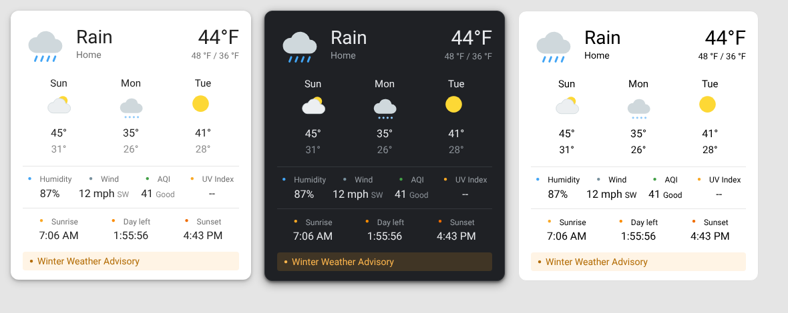

# NOAAV4 Weather Card for Home Assistant

The [MMM-NOAAV4](https://github.com/cowboysdude/MMM-NOAAV4) MagicMirror weather card, as a Home Assistant dashboard card.



- Current conditions with flat weather icons, the temperature, and today's high / low
- A 3-day forecast (0 to 5 days)
- Humidity, wind with direction, air quality (AQI) and UV index. At sunset the UV spot switches to tonight's **moon phase**, and back to UV at sunrise.
- Sunrise, sunset, and a **live countdown to sunset** (hours:minutes:seconds). After sunset it switches to **Night** with a moon, and back to the countdown at sunrise.
- Weather alerts, if you have an alerts sensor
- Comes in **white**, **dark**, **frosted glass**, or **following your Home Assistant theme**

It uses Home Assistant's own data, so it works with whatever weather integration you already have (National Weather Service, Open-Meteo, Met.no, OpenWeatherMap, and others). No API keys.

---

## Install

### Easiest: load it straight from GitHub

**Settings → Dashboards →** three dots → **Resources → Add resource**
- URL: `https://cdn.jsdelivr.net/gh/cowboysdude/MMM-NOAAV4@main/homeassistant/noaav4-card.js`
- Type: **JavaScript module**

Reload your browser. Done.

### By hand

1. Copy `noaav4-card.js` into your Home Assistant `config/www/` folder
2. **Settings → Dashboards →** three dots → **Resources → Add resource**
   - URL: `/local/noaav4-card.js`
   - Type: **JavaScript module**
3. Reload your browser

## Add it to a dashboard

Edit a dashboard → **Add card** → search for **NOAAV4 Weather Card**. Pick your weather entity, and you're done. Everything else is optional.

Or in YAML:

```yaml
type: custom:noaav4-card
entity: weather.home
css: light
```

| Option | Default | What it does |
|---|---|---|
| `entity` | *(required)* | Your weather entity, e.g. `weather.home` or `weather.kxyz_daynight`. |
| `css` | `light` | `light` = white card, `dark` = dark card, `glass` = frosted glass (see-through with a blur, for dark backgrounds), `theme` = follow your Home Assistant theme. |
| `title` | your home's name | Text under the condition, e.g. `Home Weather`. |
| `forecast_days` | `3` | Days in the forecast row: `0` (none) to `5`. |
| `details` | `true` | The humidity / wind / AQI / UV row. |
| `sun` | `true` | The sunrise / countdown / sunset row. |
| `aqi_entity` | | Optional sensor with an AQI number, e.g. from the AirNow, WAQI or IQAir integration. |
| `uv_entity` | | Optional UV index sensor, for weather integrations that don't report UV. |
| `alerts_entity` | | Optional alerts sensor. Works with the [NWS Alerts](https://github.com/finity69x2/nws_alerts) integration, or any sensor that counts alerts. Severe and extreme alerts show in red. |

Full example:

```yaml
type: custom:noaav4-card
entity: weather.home
css: dark
title: Home Weather
forecast_days: 3
aqi_entity: sensor.airnow_aqi
alerts_entity: sensor.nws_alerts
```

---

## Good to know

- **Sunrise and sunset** come from your home location in Home Assistant. When Home Assistant's `sun.sun` has today's exact times, the card uses those.
- **AQI and UV show `--`** until you add a sensor for them, unless your weather integration reports UV itself.
- **National Weather Service** sends separate day and night forecasts. The card combines them into one high and low per day. Late in the day, today's high may not be available, so the line under the temperature shows humidity instead.
- **Times and day names** follow your Home Assistant language and 12/24-hour setting.

## Troubleshooting

| What you see | Fix |
|---|---|
| "Custom element doesn't exist: noaav4-card" | The resource isn't loaded. Check the resource URL (`/local/noaav4-card.js`, type JavaScript module), then reload the browser (clear its cache if needed). |
| "Weather entity not found" | Check the entity id under **Settings → Devices & services → Entities**. |
| No forecast row | Your weather integration may not offer a daily or twice-daily forecast. Set `forecast_days: 0` to hide the row. |
| Icons missing next to Humidity, Wind, ... | Those are Home Assistant's own icons; reload the browser. |

## Credits

Card design from MMM-NOAAV4 by cowboysdude, with thanks to JimL at phphelp.com. MIT License.
